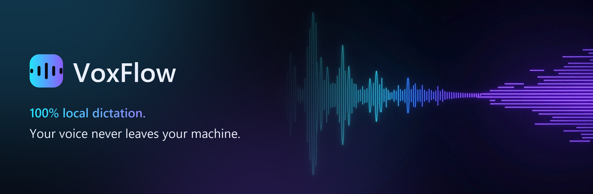
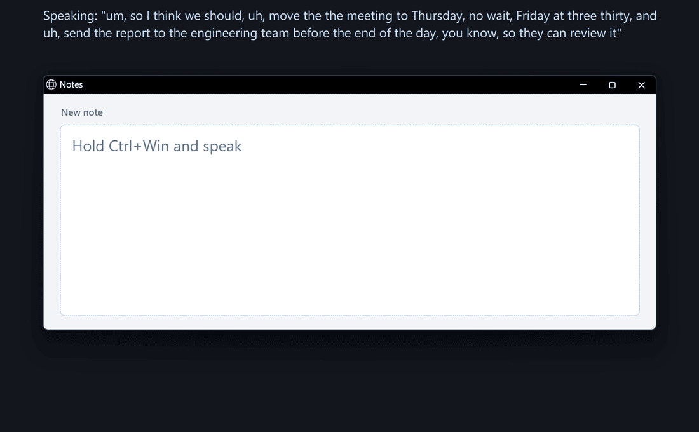
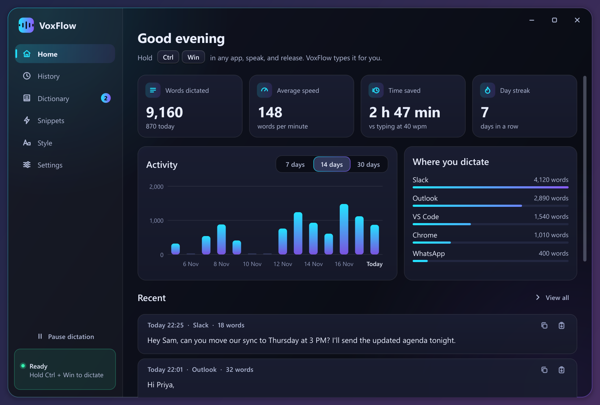
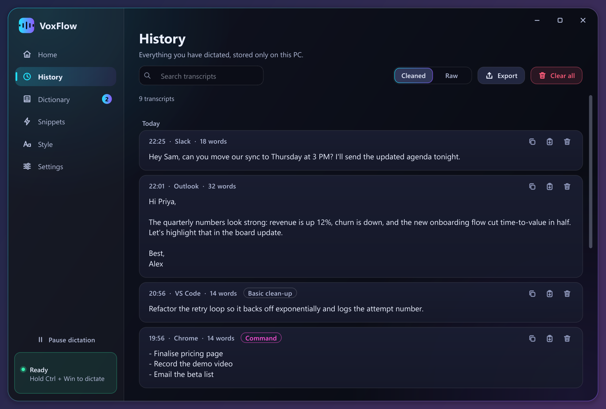
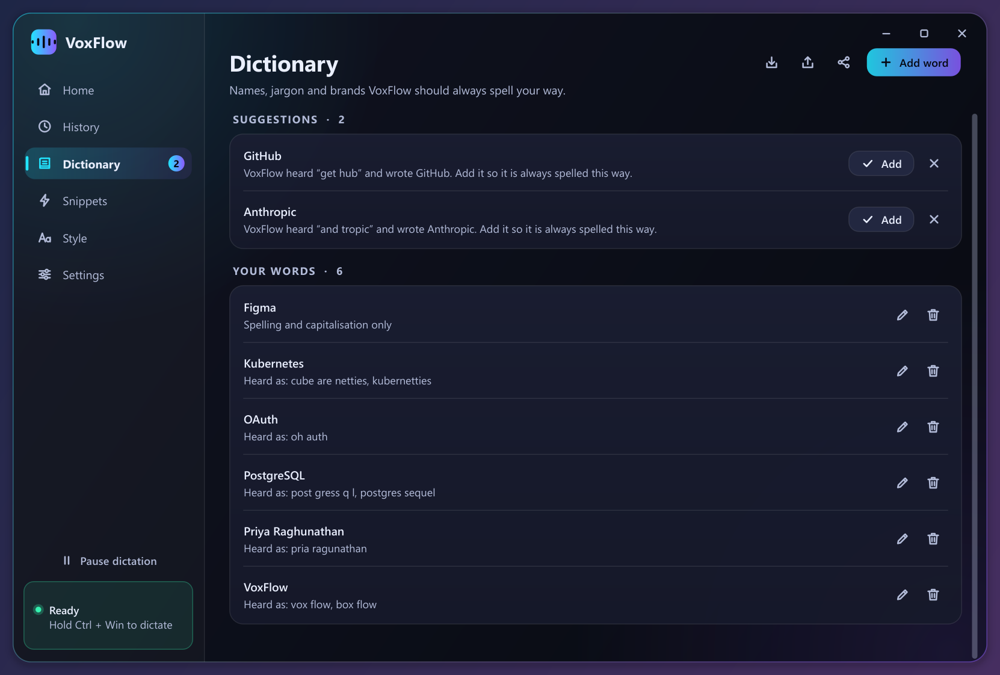
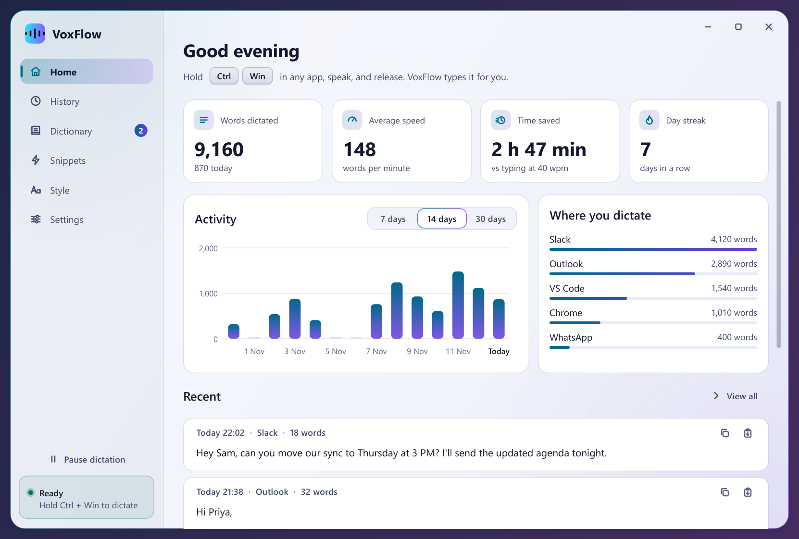
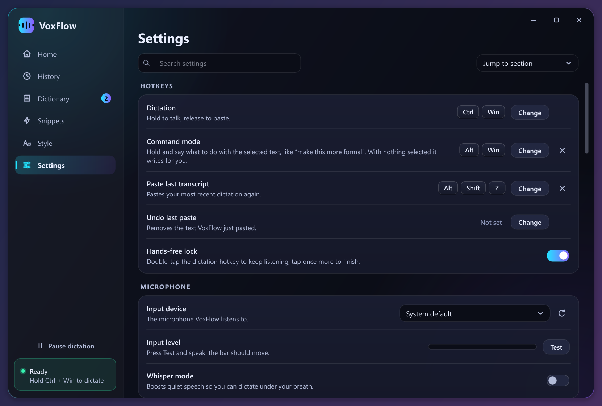
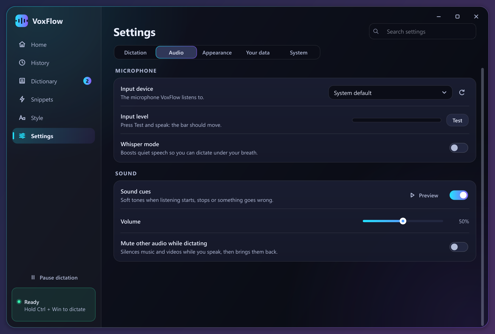
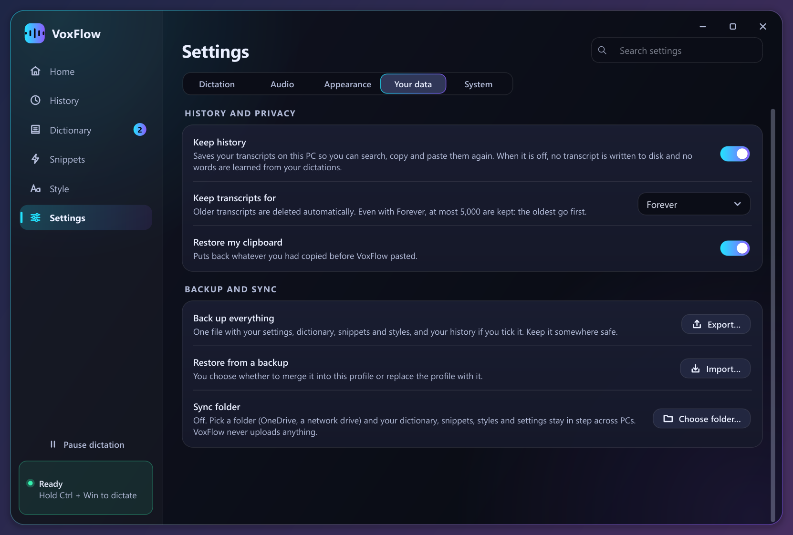

<p align="center">
  
</p>

<p align="center"><b>Hold a hotkey, speak, release. Clean, punctuated text appears in whatever app you are using,<br>
and nothing you say leaves your PC.</b></p>

<p align="center">
  <a href="https://github.com/blackknight75/voxflow/releases/latest"></a>
  <a href="LICENSE"></a>
  
  <a href="https://github.com/blackknight75/voxflow/actions/workflows/ci.yml"></a>
</p>



VoxFlow is a push-to-talk dictation app for Windows 11. Hold **Ctrl + Win**, talk, let go: your speech is
transcribed on your own machine by NVIDIA Parakeet TDT v3, tidied by a small local language model (fillers out,
punctuation in, self-corrections resolved), and pasted into the focused window.

> **1.0.0** is the first stable release. It adds no features: it fixes what a full test pass of 0.3.0 found
> (among them a sync-folder bug that could empty your dictionary on other PCs) and Esc now also cancels a
> dictation after you let go. 0.3.0 brought the [live preview](#live-preview-and-type-while-you-speak), the
> optional *Type while you speak* and [Settings](#configuration) in five tabs. All changes are in the
> [changelog](CHANGELOG.md).

## Download

### [Download the latest release](https://github.com/blackknight75/voxflow/releases/latest)

Download `VoxFlow-Setup-x.y.z.exe`, double-click, done: no admin rights, no Python.

From the command line, with [winget](https://learn.microsoft.com/windows/package-manager/winget/) or
[Scoop](https://scoop.sh) (this repository is its own Scoop bucket):

```
winget install blackknight75.VoxFlow
```

```
scoop bucket add voxflow https://github.com/blackknight75/voxflow
scoop install voxflow/voxflow
```

(The Scoop bucket follows the latest release. The winget command works once the package submission has been
accepted into the winget community repository; until then, use the installer or Scoop. Scoop unpacks the app into
its own folder instead of running the installer: details in
[packaging/scoop/README.md](packaging/scoop/README.md).)

Good to know before you start:

* **Windows shows a SmartScreen warning.** The installer is not code-signed, so you will see "Windows protected
  your PC / Unknown publisher". Choose *More info*, then *Run anyway*.
* **The installer is about 1.8 GB.** It carries the GPU runtime, so you do not need to install CUDA or anything else.
* **The models (about 5 GB) are downloaded once, on first run.** The setup guide shows the progress. After that
  VoxFlow needs no internet at all.
* **An NVIDIA GPU is recommended; other cards and a plain CPU work.** With an NVIDIA card both models run on the
  GPU through CUDA. With an AMD or Intel graphics card (a separate card with 4 GB or more) both models are meant
  to run on the GPU too: speech recognition through WebGPU, the language model through Vulkan. Without a suitable
  card everything runs on the CPU: plain dictation is still quick, and sentences that need the language model take
  about 2 seconds (see [Speed](#speed-and-accuracy)). Only an NVIDIA card (and an AMD integrated GPU) was available
  for testing: the WebGPU and Vulkan paths were run on those, and separate AMD and Intel cards are untested.
  Integrated graphics are not used at startup, because the one we measured was slower than the CPU; the
  background speed check switches to one only where it measures faster (see [Configuration](#configuration)).
* You need Windows 11 (64-bit) and free disk space for the program plus the 5 GB of models.

## Why VoxFlow

### 1. 100% local

Your voice never leaves your machine. Speech recognition and text cleanup both run on your PC. There is no
cloud service, no account and no telemetry. VoxFlow uses the network for the one-time model download from
Hugging Face on first run and, unless you switch it off, for an anonymous once-a-day check for a new version
(see [Privacy](#privacy)). The project's end-to-end self-test watches for outgoing connections while both
models load and run, and counts zero.

### 2. Works offline

Once the models are on disk, VoxFlow works with the network cable unplugged: on a plane, on a locked-down
network, anywhere.

### 3. Accurate, and fast enough to forget about

Recognition is done by [NVIDIA Parakeet TDT 0.6b v3](https://huggingface.co/nvidia/parakeet-tdt-0.6b-v3).
A rule pass and a local language model (Qwen3-4B) then clean the transcript the way a careful typist would.
For example, from the project's self-test:

> **Said:** "um so i think we should uh move the the meeting to thursday no wait friday at three thirty and uh
> send the report to the engineering team before the end of the day you know so they can review it"
>
> **Pasted:** "So I think we should move the meeting to Friday at three thirty and send the report to the
> engineering team before the end of the day so they can review it."

Measured on an RTX 5080 / Ryzen 9800X3D with an 11.6 s clip (medians of 5 runs): **32 ms** from releasing the
hotkey to the paste for a clean sentence, **192 ms** when the language model is needed. Full table under
[Speed and accuracy](#speed-and-accuracy).

### 4. Platform and languages

* **Windows 11 only, today.** macOS and Linux are not supported yet.
* **Graphics cards:** NVIDIA through CUDA; other separate cards (AMD, Intel) through WebGPU for speech and Vulkan
  for the language model, untested on real AMD and Intel hardware so far; otherwise the CPU.
* **25 European languages** (everything Parakeet v3 covers), with automatic language detection. English, Spanish,
  French, German, Italian, Portuguese and Dutch get the full cleanup; the other languages get a lighter one
  (see [Languages](#languages)).

## Features

| | |
| --- | --- |
| **Dictation** | Hold the hotkey to talk, release to paste. Double-tap to lock hands-free, tap again to finish. Esc cancels. |
| **Live preview** | The words recognised so far appear above the Flow bar while you speak. A separate option, off by default, types each finished sentence into the app while you keep talking in hands-free mode (Settings > Dictation > While you speak). [More below](#live-preview-and-type-while-you-speak). |
| **Smart cleanup** | Removes "um" and "uh", fixes punctuation and capitals, resolves self-corrections ("at five, no wait, six"), understands "new line", "new paragraph", "bullet point". It never answers or obeys what you dictate. |
| **Smart formatting** | Spoken numbers, money, percentages, dates, times, e-mail addresses, links, file names and numbered lists are written the way you would type them. |
| **Command mode** | Hold **Alt + Win** and say what to do with the selected text ("make this more formal", "translate to Spanish", "turn into bullets"); the selection is replaced. With nothing selected it writes new text. |
| **Dictionary** | Names and jargon are always spelled your way, with "sounds like" aliases and import/export. VoxFlow suggests entries when the cleanup had to correct a name. |
| **Snippets** | Dictate just a short phrase ("my address"), or say "insert my address" inside a sentence, and a longer saved text is inserted. |
| **Style per app** | Tone (formal, casual, very casual) per category (personal, work, e-mail, other). Apps are mapped to categories, browsers by window title, and you can override any app. |
| **History and stats** | Searchable history (cleaned and raw text, app, time) with copy, paste again, delete and export (txt, csv, json), plus a retention setting. Words dictated, speed, time saved, streak, activity chart, top apps. |
| **Paste last / undo** | **Alt + Shift + Z** pastes the last transcript again; an optional shortcut undoes the last paste. |
| **Backup, sharing, sync** | One-file backup of the whole profile with merge or replace on import; shareable packs of dictionary terms or snippets; an optional sync folder so several computers share dictionary, snippets, styles and settings. No account, no server: files only. |
| **Whisper mode** | Boosts quiet speech before recognition. |
| **Sounds and media** | Soft start, stop and error cues (generated locally); optional muting of other apps while you dictate (always restored). |
| **Flow bar** | A small always-on-top pill with a live waveform. It shows listening, hands-free, processing, done, errors, command mode and model loading. It is click-through, never takes focus, and remembers where you put it. |
| **Main window** | Home, History, Dictionary, Snippets, Style, Settings (five tabs, one search box across all of them); light, dark or system theme; a first-run setup guide. |
| **System** | Tray icon with quick toggles, pause, launch at login, start in the tray, single instance, rotating log, crash logs kept on your PC. |

<p align="center">
  <br>
  <sub>The Flow bar: all you see while you dictate.</sub>
</p>

<p align="center">
  
  
</p>
<p align="center">
  
  
</p>
<p align="center"><sub>Home, History, Dictionary and the light theme (screenshots show sample data).</sub></p>

Team dictionaries and device sync are covered without a cloud: by packs and by the sync folder. Features that
would need a cloud service, an account or a phone app are out of scope by design.

### Live preview and Type while you speak

<p align="center">
  <br>
  <sub>Live preview: the caption fills in as you speak, and the newest word stays dimmed until the next one
  confirms it. (Rendered from the real Flow bar with scripted words.)</sub>
</p>

**Live preview** (on by default) shows the words recognised so far in a caption above the Flow bar, so you can see
that VoxFlow is hearing you before you let go. It is only a preview: what gets pasted is still the transcript of the
whole recording, tidied up by the cleanup after you release the key. It works for hold-to-talk, hands-free and
command mode. Switch it off under Settings > Dictation > While you speak. On a PC that is too slow to keep up, the
preview pauses itself and Settings says so; dictation works as before.

<p align="center">
  <br>
  <sub>Hands-free mode with the caption: the lock means you can let go of the hotkey.</sub>
</p>

**Type while you speak** (hands-free mode only, **off by default**) goes one step further. Double-tap the hotkey
and each finished sentence is pasted into the app you are in while you keep talking, about 2 seconds behind your
voice on a GPU; the last sentence is pasted when you tap the hotkey to stop. Switch it on under Settings >
Dictation > While you speak. It is new and has had little real-world use so far, so a few things to know:

* Text that is already pasted is not revised. A pause of about 1.5 seconds in the middle of a sentence is typed as
  a sentence end.
* The text follows the cursor: if you change windows, the next sentence goes to the new window. Nothing is pasted
  into VoxFlow's own window; that sentence waits for the next one.
* Undo removes the last pasted sentence only, and not while you are still dictating. History keeps one entry per
  dictation. Snippets are not expanded in a dictation that was typed this way; the dictionary still applies.
* On a slow PC without a GPU the preview can fall behind; typing then stops for that dictation and the rest is
  pasted when you stop, so no words are lost.
* Hold-to-talk and command mode are unchanged: they paste once, when you release the key.

### Languages

Auto-detect, or pick one of the 25 European languages Parakeet v3 supports: Bulgarian, Croatian, Czech, Danish,
Dutch, English, Estonian, Finnish, French, German, Greek, Hungarian, Italian, Latvian, Lithuanian, Maltese,
Polish, Portuguese, Romanian, Russian, Slovak, Slovenian, Spanish, Swedish and Ukrainian.

* **Full cleanup** (fillers, self-corrections, spoken punctuation, smart formatting, tone, and a language-model
  pass in that language): English, Spanish, French, German, Italian, Portuguese, Dutch.
* **Basic cleanup** (hesitation sounds removed, capitals, a final stop): the other 18 languages.

## How to use it

| Shortcut | What it does |
| --- | --- |
| **Hold Ctrl + Win** | Dictate. Release to paste. |
| **Double-tap Ctrl + Win** | Lock hands-free. Tap again to stop. |
| **Esc** | Cancel: while you record, or after you let go while the text is still being worked on. Nothing is pasted and nothing is kept (the Esc is not passed on to the app). |
| **Hold Alt + Win** | Command mode: say what to do with the selected text. |
| **Alt + Shift + Z** | Paste the last transcript again. |

All shortcuts can be changed in Settings; an "undo last paste" shortcut is available but off by default.

* The Start menu does not open and no keys leak into the app. Pressing any other key while holding the hotkey
  cancels: it was a different shortcut.
* Recordings shorter than about 0.3 s are ignored; a single recording is capped at 2 minutes (configurable).
* Speech that is only fillers pastes nothing; a lone "new line" pastes the line break.
* Command mode needs the language model. The result is pasted only into the window you started in; if you
  switched windows meanwhile it is left on the clipboard instead.
* If the paste cannot be sent (for example the target window runs as administrator) the text stays on the
  clipboard ("Copied. Press Ctrl+V") and the transcript is kept in History.
* If the language model is too slow for a sentence, the text gets the rule clean-up only and VoxFlow says so:
  `· basic clean-up` on the Flow bar and a "Basic clean-up" tag on that History row.
* Closing the main window hides it; VoxFlow keeps running in the tray. Quit from the tray menu. Only one
  instance runs per user; starting VoxFlow again brings the running window to the front.
* Tray: left-click opens the window, right-click opens the menu (status, pause, smart cleanup, sound cues,
  microphone, paste last transcript, Settings, quit).

**First run.** The first launch opens a short setup guide (microphone check, model download, hotkey practice) and
downloads the two models. The hotkey practice opens once the speech model is ready (straight away when it is already
downloaded). Progress is shown in the Flow bar, in the setup guide and under Settings > System > On-device models; closing the
guide does not stop the download.

**Backup.** Settings > Your data > Backup and sync > Export writes one `.voxbackup` file (history optional). Import shows
what the file holds first and lets you tick the parts to import; *Merge* only adds what is missing (settings
are left alone), *Replace* makes the ticked parts equal to the file. Settings that describe a computer
(microphone, models, launch at login) are only restored on the computer the backup came from.

**Packs.** Dictionary and Snippets have Share and Import: a `.voxpack` file holds terms or snippets only (never
history or settings), and when sharing you tick the entries that go in. Importing adds new entries and updates
the ones you already have.

**Sync folder.** Pick a folder that your own sync tool (OneDrive, Dropbox, Syncthing, a network share) keeps in
step between computers. Each computer writes one file of its own there; the newest change to an entry wins,
deletions are remembered for 180 days, and history and statistics never leave the computer. If the folder is
unreachable the status row says so and changes sync when it is back. VoxFlow itself contains no network code
for this: it only reads and writes files.

## Configuration

Everything can be changed on the Settings page. It is grouped into five tabs, and the search box beside the title
looks through all of them (it also understands everyday words: "shortcut" finds every hotkey, "gpu" the device
choices):

| Tab | Sections |
| --- | --- |
| **Dictation** | Hotkeys, Language and text (language, smart cleanup, smart formatting, learn new words), While you speak (live preview, type while you speak) |
| **Audio** | Microphone (input device, level test, whisper mode), Sound (cues, volume, muting other apps) |
| **Appearance** | Theme and reduced motion, Flow bar (show when idle, position) |
| **Your data** | History and privacy (keep history, retention, restore clipboard), Backup and sync |
| **System** | Startup, Updates, On-device models (where each model runs, the speed check), Help and about |

<p align="center">
  
</p>
<p align="center">
  
  
</p>
<p align="center"><sub>The Dictation, Audio and Your data tabs.</sub></p>

The file behind it is `%APPDATA%\VoxFlow\config.json`. Invalid values are replaced by the default when the file
is loaded, numbers are clamped to the range shown, and an unreadable file is kept as `config.json.bad`.

<details>
<summary><b>All settings</b></summary>

| key | default | meaning |
| --- | --- | --- |
| `hotkey` | `"ctrl+win"` | Hold to dictate. Modifiers `ctrl`, `alt`, `shift`, `win` plus at most one key; a lone letter, a lone modifier, Esc and common Windows shortcuts are refused |
| `command_hotkey` | `"alt+win"` | Hold for command mode; `""` switches it off |
| `paste_last_hotkey` | `"alt+shift+z"` | Paste the last transcript again; `""` = off |
| `undo_hotkey` | `""` | Undo the last paste (Ctrl+Z in the window that received it); `""` = off |
| `double_tap_lock` | `true` | Double-tap the dictation hotkey for hands-free |
| `cleanup_enabled` | `true` | Run the cleanup (language model + rules). Off = paste exactly what was heard |
| `smart_formatting` | `true` | Write spoken numbers, dates, e-mails, links, lists as typed text |
| `auto_learn` | `true` | Suggest dictionary entries from corrections |
| `language` | `"auto"` | `auto` or a language code (`en`, `de`, `fr`, `es`, ...) |
| `whisper_mode` | `false` | Boost quiet speech |
| `mic_device` | `null` | `null` = system default, or the device name |
| `sounds_enabled` / `sound_volume` | `true` / `0.5` | Sound cues, volume 0..1 |
| `mute_media` | `false` | Mute other apps' audio while dictating |
| `launch_at_login` / `start_minimized` | `false` / `false` | Start with Windows / start in the tray |
| `save_history` | `true` | Keep transcripts (stats are counted either way) |
| `history_retention_days` | `0` | 0 = forever, else 1..3650 days |
| `history_limit` | `5000` | Maximum stored transcripts (10..100000) |
| `restore_clipboard` | `true` | Put your previous clipboard back after pasting |
| `restore_delay_s` | `0.5` | Wait after Ctrl+V before restoring (0.05..5); raise for slow apps |
| `show_idle_pill` | `false` | Show the Flow bar while idle (off: it appears only while a hotkey is in use, on the screen you are working on) |
| `live_preview` | `true` | Show the words recognised so far above the Flow bar while you speak |
| `phrase_streaming` | `false` | Hands-free mode: paste each finished sentence while you keep talking (not synced between PCs) |
| `theme` | `"system"` | `system`, `dark` or `light` |
| `reduced_motion` | `false` | Turn off decorative animation |
| `overlay_position` | `null` | Remembered Flow bar position `[x, y]`; `null` = bottom centre of the active screen |
| `update_mode` | `"notify"` | Updates: `auto` (install automatically), `notify` (tell me, I choose) or `off` (never check) |
| `update_install_when` / `update_time` | `"quit"` / `"03:00"` | Automatic installs: when you quit VoxFlow, or at that time of day (local, `HH:MM`) when VoxFlow and the PC are idle |
| `asr_model` / `asr_device` | Parakeet TDT 0.6b v3 / `"auto"` | Advanced; device `auto` (the fastest device the speed check measured, see the [FAQ](#faq-and-troubleshooting)), `cuda` (NVIDIA), `webgpu` (any graphics card, integrated ones included) or `cpu`. A change applies at once |
| `cleanup_model` | `null` | Advanced; `"repo:file.gguf"` or a path; `null` = built-in default |
| `cleanup_device` | `"auto"` | Advanced; where the language model runs: `auto`, `cuda`, `vulkan` (any graphics card) or `cpu`. Applies when VoxFlow restarts |
| `cleanup_timeout_s` / `command_timeout_s` | `4.0` / `20.0` | Time limits for the language model (0.5..30 / 2..120) |
| `min_record_s` / `max_record_s` | `0.3` / `120` | Ignore taps / hard recording cap (0.05..5 / 5..3600) |

</details>

## Privacy

VoxFlow is built so that there is nothing to trust: audio and text are processed on your PC and stay there.

**What touches the network**

* The one-time download of the two models from Hugging Face on first run (and again only if you change the
  model in the advanced settings or delete the cache). Hugging Face usage telemetry is switched off.
* The update check (Settings > System > Updates), unless you set it to *Off (never check)*. Once a day, a few minutes
  after VoxFlow starts, and when you press *Check now*, it sends one anonymous HTTPS request to the GitHub API
  for the newest published VoxFlow release. The only identifying header is the generic User-Agent
  `VoxFlow/<version>`: no ID, no cookie, nothing about you or your PC. If you choose to install an update,
  VoxFlow downloads `VoxFlow-Setup-<version>.exe` and `SHA256SUMS.txt` from that release, only from
  `github.com/blackknight75/voxflow` and GitHub's download servers over HTTPS, and refuses the installer if its
  SHA-256 does not match. *Off* means no automatic update traffic at all (no check at start, none daily): VoxFlow
  then asks GitHub only when you press *Check now*. Switching to *Off* also deletes a downloaded installer and
  cancels any pending install. A copy installed with Scoop or winget, installed for all users (Program Files), or
  run from source never updates itself: it only tells you that a new version exists. If you start VoxFlow while
  an update is being installed, it says "Finishing the update…" and does not start until Setup is done.
* Nothing else. No account, no analytics, no crash upload. Audio, transcripts, dictionary and settings are
  never sent anywhere.

**Why Windows shows "VoxFlow is using your microphone"**

VoxFlow keeps the microphone open while it runs, also when it is paused. That is how it keeps the 0.3 seconds
*before* you press the shortcut, so a first word you start saying as you press is not cut off. Opening the
microphone only when you press would lose that, and a little more while the device starts. Until you hold the
shortcut, the sound goes into a 2-second buffer in memory that is overwritten all the time. It is never written to
disk, transcribed or sent anywhere. On a Bluetooth headset an open microphone keeps the headset in its call mode,
which makes music sound worse: choose another microphone in Settings > Audio > Microphone (for example the PC's own)
to avoid that. Quitting VoxFlow closes the microphone.

**What is stored, and where**

| Where | What |
| --- | --- |
| `%APPDATA%\VoxFlow\config.json` | Your settings |
| `%APPDATA%\VoxFlow\history.json`, `stats.json` | Transcripts (if "save history" is on) and usage statistics |
| `%APPDATA%\VoxFlow\dictionary.json`, `snippets.json`, `styles.json` | Your dictionary, snippets and per-app styles |
| `%APPDATA%\VoxFlow\logs\` | `voxflow.log` (rotating, 1 MB x 3) and `crash-*.log`. They stay on your PC. |
| `%LOCALAPPDATA%\VoxFlow\cuda-cache\` | Compiled GPU kernels, so later starts are fast. Removed by the uninstaller |
| `%APPDATA%\VoxFlow\speedcheck.json` | How fast each device ran the models on this PC (the speed check). Never in a backup or the sync folder |
| `%APPDATA%\VoxFlow\updates.json` | The last update check: when, its result, the newest version seen and your choices (skip, remind later) |
| `%TEMP%\VoxFlow-update\` | At most one downloaded update installer, while it waits to be installed. Deleted after the update, when you skip that version or switch updates off |
| `%USERPROFILE%\.cache\huggingface\hub\` | The downloaded models (the standard Hugging Face cache) |
| A sync folder, only if you choose one | Dictionary, snippets, styles and settings. Never history or statistics. |

Recorded audio is held in memory for the transcription and is not written to disk. You can switch history off
(Settings > Your data > History and privacy > Keep history; VoxFlow then offers to delete what is already saved), set a
retention period, or clear it at any time (History > Clear all). With history off no transcript is written to disk.
The log file never contains dictated text: errors while handling your words are logged by type and place only.

## Speed and accuracy

Real models, 11.6 s clip, RTX 5080 / Ryzen 9800X3D, medians of 5 runs (measured 2026-11-14 with
`scripts\e2e_selftest.py`; method in [docs/DEVELOPMENT.md](docs/DEVELOPMENT.md#measured-speed)):

| | GPU | forced CPU |
| --- | --- | --- |
| speech recognition | 30 ms | 263 ms |
| release to paste, clean sentence (no language model needed) | 32 ms | 245 ms |
| language-model cleanup of a 41-word disfluent sentence | 155 ms | 1630 ms |
| release to paste when the language model is needed | 192 ms | 1901 ms |

The design target is 1.5 s from release to paste for a 10 s utterance. On CPU, sentences that need the
language model exceed it. Switching Smart cleanup off avoids that wait, but then the raw transcript is pasted
with no cleanup at all.

These are numbers from one machine, not a benchmark suite. For recognition accuracy across languages, see the
[Parakeet TDT v3 model card](https://huggingface.co/nvidia/parakeet-tdt-0.6b-v3).

## FAQ and troubleshooting

**Is it really offline?** Yes, after the first run. The models are downloaded once; from then on no network is
needed. The only other request is the daily update check, which you can turn off in Settings > System > Updates
(*Off (never check)*; *Check now* still works when you ask); dictation never waits for it.

**How do updates work?** Settings > System > Updates offers three modes: *Install automatically*, *Notify me, I choose*
(the default) and *Off (never check)*. When a new version is out you get a notification and a dialog with its
release notes and four choices: *Install now* (VoxFlow restarts, after any dictation in progress), *Install when
I quit*, *Remind me later* (tomorrow) and *Skip this version*. In automatic mode VoxFlow downloads the update in
the background (not on a metered connection) and installs it when you quit, or at a time you set, when VoxFlow
and the PC have been idle for 10 minutes. It never installs while you dictate. The installer is not code-signed:
the SHA-256 check proves the file is the one published with the release, not who built it. With Scoop
(`scoop update voxflow`) or winget (`winget upgrade blackknight75.VoxFlow`), the package manager does the updating.

**Does it work without an NVIDIA GPU?** Yes. On a separate AMD or Intel graphics card with 4 GB or more, speech
recognition uses the GPU through WebGPU and the language model through Vulkan (both were run on an NVIDIA card
only: not yet tested on an AMD or Intel card). On a PC without a suitable card everything runs on the CPU. Plain
dictation stays fast; on the CPU, sentences that need the language model take about 2 s. Settings > System > On-device
models shows where each model runs. Integrated graphics are not used on the first start (on the one we measured,
an AMD Radeon, both models were slower than on the CPU), but the speed check below measures them too and switches
to one that is clearly faster on your PC.

**What does "Automatic" do, and how do I pick a device?** VoxFlow starts on a fixed order (NVIDIA CUDA, then a
separate graphics card, then the CPU), so nobody waits. Once both models are loaded and you are not dictating, it
runs a one-time speed check in the background: each device that works on your PC runs each model briefly, in a
separate process at low priority, and it stops at once when you start dictating. Automatic then uses the fastest
one, but only if it is at least 15% and 10 ms faster than the fixed choice, so a measurement can never make
VoxFlow slower. The result is kept for this PC and measured again only after a driver, hardware or VoxFlow update,
or when you press **Measure again** in Settings > System > On-device models. There you can also pick a device yourself; the
menu shows each measured time and why a device is unavailable. A speech recognition change applies at once; a
language model change applies when VoxFlow restarts. `VOXFLOW_DEVICE` (see Troubleshooting) overrides all of this.

**Does it run on macOS or Linux?** No. VoxFlow is Windows 11 only today.

**Why does Windows warn me about the installer?** It is not code-signed. Choose *More info*, then *Run anyway*.

<details>
<summary><b>Troubleshooting</b></summary>

* **Flow bar says "Loading / Downloading speech model":** first run downloads the models; progress is under
  Settings > System > On-device models. If it failed (no internet), connect once and press **Try again** there.
* **"Speech model unavailable":** see `%APPDATA%\VoxFlow\logs\voxflow.log` (Settings > System > Help and about > Logs), then Try again.
* **Cleanup is slow or Settings shows the cleanup model as "Limited":** the language model is not loaded and
  only the rule-based cleanup runs (command mode is off). On a source install the llama.cpp libraries are
  usually missing: run `.venv\Scripts\python.exe -m voxflow.cleanup --install-cuda` and
  `.venv\Scripts\python.exe scripts\fetch_llama_backends.py`. The log names the build that was loaded and why.
* **Recognition is slower than about 0.1 s per 10 s of audio:** it runs on the CPU (expected without a separate
  graphics card) or fell back to it. Check the backend in Settings > System > On-device models and make sure the GPU driver
  is current; the log line `speech recognition runs on ...` says why a GPU was passed over. On a source install, make sure only
  `onnxruntime-gpu` is installed (`.venv\Scripts\python.exe -m pip list | findstr onnxruntime`).
* **"Shortcuts unavailable":** the keyboard hook could not be installed; restart VoxFlow.
* **Hotkey does nothing in some windows / "Copied. Press Ctrl+V":** Windows blocks keyboard hooks and
  synthetic input for elevated (admin) windows and UAC prompts unless VoxFlow also runs as administrator.
* **"Basic clean-up" on the Flow bar or in History:** the language model did not answer in time for that
  dictation (usually the GPU was busy), so fillers and punctuation were fixed by rules only. Nothing is lost;
  if it keeps happening VoxFlow shows one notice. Raising `cleanup_timeout_s` gives the model more time.
* **Text pastes late or the old clipboard shows up in a slow app:** raise `restore_delay_s` (try `1.0`).
* **"Microphone problem" / nothing is recorded:** choose the microphone in Settings or the tray menu, use
  Settings > Audio > Microphone > Test, and check that Windows Settings > Privacy & security > Microphone allows
  desktop apps. A microphone that is unplugged while you speak ends the recording and uses what was said.
* **"Heard only silence":** the microphone is muted or the wrong device is selected.
* **A shortcut is refused:** it is used by another VoxFlow action, by Windows, or would get in the way of typing.
* **Command mode says it needs the language model:** see "Limited" above.
* **Other apps stayed muted after a crash:** start VoxFlow once; it restores them at start-up.
* **Launch at login does nothing:** the install was moved; switch the setting off and on again.
* **Reset everything:** Settings > System > Help and about > Reset (keeps your data), or quit VoxFlow and delete `%APPDATA%\VoxFlow`.
* **Debugging an installed copy:** `VoxFlow-console.exe` next to `VoxFlow.exe` is the same program with a
  console window (`VoxFlow-console.exe --selftest [clip.wav]`). `set VOXFLOW_DEVICE=cpu` before starting it
  forces the CPU path for both models; `cuda` forces the NVIDIA path, and `webgpu` or `vulkan` (the same thing)
  the path for any graphics card. Use `cpu` if a graphics driver makes VoxFlow crash or stall.

</details>

## Update and uninstall

* **Update:** run a newer installer; it updates the installed copy in place.
* **Install details:** the installer is per-user (no administrator rights), installs to
  `%LOCALAPPDATA%\Programs\VoxFlow`, adds a Start menu entry and an optional desktop shortcut. *Launch at login*
  is the app's own switch (Settings > System > Startup); the installer does not add a second one.
* **Uninstall:** Windows Settings > Apps, or the uninstaller in the install folder. It first asks a running
  VoxFlow to close (so what it has not saved yet is saved, and apps it muted get their sound back), then removes
  the program files, the *Launch at login* entry and the GPU kernel cache, nothing else. For a complete removal, also delete `%APPDATA%\VoxFlow` (settings, history, dictionary) and
  the two model folders in `%USERPROFILE%\.cache\huggingface\hub` (`models--istupakov--parakeet-tdt-0.6b-v3-onnx`
  and `models--bartowski--Qwen_Qwen3-4B-Instruct-2507-GGUF`).

## Build from source

You need Windows 11, Python 3.12 (64-bit), about 6 GB of free disk for the packages and models, and internet
for the install and the first run.

```bat
git clone https://github.com/blackknight75/voxflow.git
cd voxflow
python -m venv .venv
.venv\Scripts\python.exe -m pip install --upgrade pip
.venv\Scripts\python.exe -m pip install -r requirements.txt --only-binary=:all:
.venv\Scripts\python.exe -m voxflow.cleanup --install-cuda
.venv\Scripts\python.exe scripts\fetch_llama_backends.py
run.bat
```

The install notes (why `--only-binary`, the Windows path-length limit), launch flags, the self-test, building
the installer, the test suite, how the speed numbers are measured and the architecture are in
**[docs/DEVELOPMENT.md](docs/DEVELOPMENT.md)**. To contribute, read **[CONTRIBUTING.md](CONTRIBUTING.md)**;
to report a vulnerability, see **[SECURITY.md](SECURITY.md)**. Release notes are in **[CHANGELOG.md](CHANGELOG.md)**.

## License and acknowledgements

VoxFlow is released under the [MIT License](LICENSE).

It stands on these models and libraries. The models are downloaded from Hugging Face on first run and are not
part of this repository or the installer; check each model card for the authoritative terms.

| Component | Used for | License |
| --- | --- | --- |
| [NVIDIA Parakeet TDT 0.6b v3](https://huggingface.co/nvidia/parakeet-tdt-0.6b-v3), in the [ONNX conversion by istupakov](https://huggingface.co/istupakov/parakeet-tdt-0.6b-v3-onnx) | Speech recognition | CC BY 4.0 (see model card) |
| [Qwen3-4B-Instruct-2507](https://huggingface.co/Qwen/Qwen3-4B-Instruct-2507), in the [GGUF quantisation by bartowski](https://huggingface.co/bartowski/Qwen_Qwen3-4B-Instruct-2507-GGUF) (Q4_K_M) | Text cleanup and command mode | Apache 2.0 (see model card) |
| [onnx-asr](https://github.com/istupakov/onnx-asr) and [ONNX Runtime](https://github.com/microsoft/onnxruntime) | Running the speech model | MIT |
| [llama.cpp](https://github.com/ggml-org/llama.cpp) through [llama-cpp-python](https://github.com/abetlen/llama-cpp-python) | Running the language model | MIT |
| [Qt for Python (PySide6)](https://doc.qt.io/qtforpython-6/) | User interface | LGPL v3 |
| [NumPy](https://numpy.org/), [sounddevice](https://github.com/spatialaudio/python-sounddevice) (PortAudio), [huggingface_hub](https://github.com/huggingface/huggingface_hub) | Audio and model download | BSD 3-Clause, MIT, Apache 2.0 |
| NVIDIA CUDA runtime libraries (cuDNN, cuBLAS and others) | GPU acceleration | NVIDIA software license terms |
| [ONNX Runtime WebGPU execution provider](https://pypi.org/project/onnxruntime-ep-webgpu/) (Microsoft), built on [Dawn](https://dawn.googlesource.com/dawn) | Speech recognition on AMD, Intel and NVIDIA graphics cards | MIT; Dawn: BSD 3-Clause (the package's ThirdPartyNotices lists the rest) |
| DirectX Shader Compiler (`dxcompiler.dll`, Microsoft), shipped inside that package | Compiling the GPU programs for Direct3D 12 | The package carries no separate licence text for it; see the [upstream project](https://github.com/microsoft/DirectXShaderCompiler) |
| [PyInstaller](https://pyinstaller.org/) and [Inno Setup](https://jrsoftware.org/isinfo.php) | Building the installer | GPL v2 with bootloader exception; Inno Setup License |
